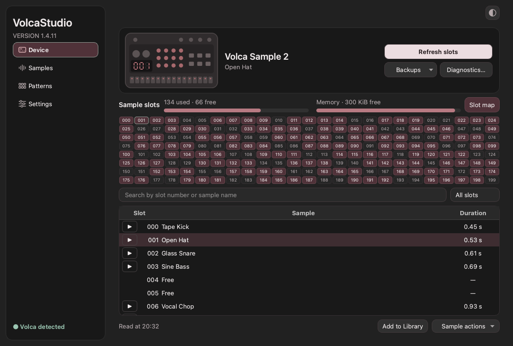

# VolcaStudio

A macOS companion for the Korg Volca Sample 2. Organize WAVs and sample slots, preview USB transfers, and back up samples and patterns.

[Download macOS Beta 1](https://github.com/ondamondah/VolcaStudio/releases/tag/v1.4.11-beta.1) · [Setup and first test](START-HERE.md) · [Report beta feedback](https://github.com/ondamondah/VolcaStudio/issues)

## Help test on a Mac

Installation has been verified on Intel with macOS 13.7.8. Apple Silicon testing is welcome. Python 3.11 is required. Read the device slots, save a snapshot, and open its restore preview. The first test does not write to the Volca.

VolcaStudio is an independent project for Korg Volca Sample 2 owners.
